  

  <a href="https://nico-myproject.github.io/">Portfolio</a> •
  <a href="https://nico-alfianto.github.io/projects.html">Projects</a> •
  <a href="mailto:alfiantonico9@gmail.com">Email</a> •
  <a href="https://instagram.com/alfntnico">Instagram</a>

---

### Stack

  
  
  
  
  
  
  
  
  
  

  Python • SQL • Power BI • Excel • Laravel • PHP • HTML • CSS • JavaScript

---

### Projects

  
  

  
  

  
  

---

  © 2026 Nico Alfianto — Bogor • Data → Insights → Decisions

